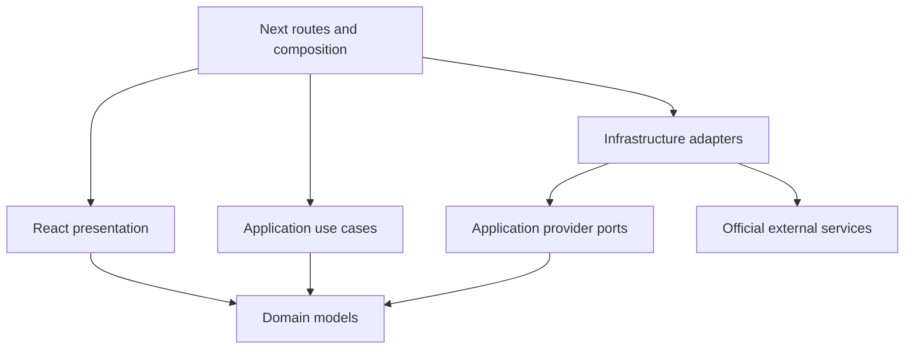
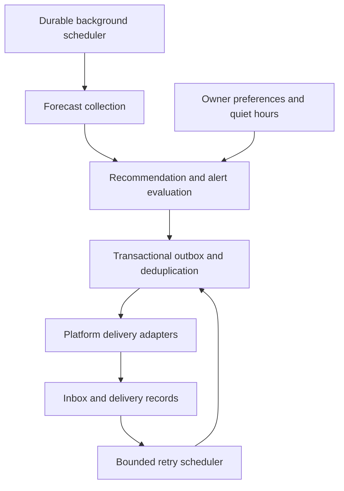

# Architecture: current foundation and intended expansion

## Baseline
Prior repository: documentation plus a board workflow, no executable architecture. ADR 001 defines the new foundation.

## Dependency and integration design

Only composition selects concrete adapters. Domain has no framework, storage or HTTP dependencies. Provider transport is injected so failures and contracts can be tested without pretending fixtures are live data.

## Environmental data flow
A selected station is validated → adapter requests an explicitly documented product → response is validated/normalized → application assesses missing/stale information → presentation labels source, timestamp and observation/forecast type. Station observations are not exact shoreline conditions. Missing data never becomes a zero value. Recommendations require a separately validated species/habitat model and access/regulatory checks.

## Proposed persistence model (not implemented)
User identity belongs to an established authentication provider. SavedHoneyHole stores id, ownerId, name, coordinates, optional notes, privacy (default private), createdAt and updatedAt. CatchLog references owner and optional location with species, time and photo metadata. Sharing a report is separate from permission to publish coordinates. Regulation records retain species, jurisdiction, geometry applicability, effective/expiry dates, source URL and verifiedAt. Measurements retain unit, value, source, observedAt/validAt, retrievedAt, coordinate/station reference, observation/prediction kind and missing state.

## Proposed authorization flow (not implemented)
Provider login → server verifies session → use case receives verified owner identity → repository query enforces owner/public visibility → output projection strips private coordinates for unauthorized viewers. UI visibility alone is never authorization. Mutation requires identity, ownership, input validation and CSRF protection appropriate to the session transport. Logout invalidates session through provider. Private records must never enter public caches.

## Proposed geospatial workflow (not implemented)
Validate coordinates → exact California supported-domain geometry → shoreline/access datasets → protected-area/restriction checks → species/habitat evidence → environmental coverage → explainable relative suitability. A bounding box alone is not proof of California membership, access or legality. Unknown access/regulations prevent positive recommendations. No crowd estimate without evidence.

## Testing architecture
Vitest tests pure domain/application behavior and provider contracts using isolated fixtures. React Testing Library tests user-visible states. Production HTTP checks verify route assembly. Browser E2E will cover auth, saved locations, maps and sharing when implemented. Coverage and live API success are distinct from contract fixtures. Current verification is recorded in docs/project/test-results.md.

## Updated regional and platform architecture
See ADR 003. California configuration now lives in src/config/regions.ts. Provider adapters normalize data; application services enforce region policy. Geographic, jurisdiction, water-body, species-distribution and location models are reusable. Metadata state membership is not a boundary dataset or proof of public access.

Versioned v1 JSON contract: docs/api/openapi.json. Mobile applications are not started. Web quality gates precede Android; Android precedes iOS.

## Planned durable notification flow (interfaces exist; services not implemented)

The future worker runs independently of browser sessions. Recheck opt-out, expired/updated forecasts, safety, authorization and quiet hours at delivery time. IANA user and fishing-location zones stay separate; DST transitions require explicit tests. Notification preferences default disabled; exact-coordinate sharing must default false in persistence/UI implementation. Do not infer that the current contracts enforce these defaults at runtime.

Persistence strategy (planned): versioned PostgreSQL migrations with foreign keys, owner-scoped access, transactional outbox uniqueness, delivery attempt records and subscription revocation. Evaluate PostGIS for region/access geometry queries before schema implementation. No database, job runner, subscription encryption, push adapter or real notification delivery exists yet. Never use an in-memory queue as evidence of background reliability.
